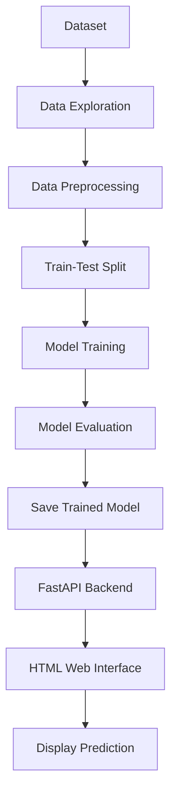

# ❤️ Heart Disease Prediction Web Application

<p align="center">
  
  
  
  
</p>

<p align="center">
  <b>An ML-powered web application for heart disease prediction using Python, scikit-learn, FastAPI, and HTML.</b>
</p>

---

## 📌 About the Project

Heart Disease Prediction is a machine learning project that analyzes health-related attributes and generates a prediction using a trained classification model.

The application integrates a machine learning model with a FastAPI backend and an HTML interface, allowing users to submit input values and view the prediction.

🎯 **Objective:** Demonstrate the practical integration of machine learning models into a web application.

> ⚠️ **Disclaimer:** This project is intended for educational purposes only. It is not a medical diagnostic tool and must not replace professional medical advice.

## ✨ Key Features

- ❤️ Heart disease prediction using a trained ML model
- 🌐 Interactive web interface for entering health-related information
- ⚡ FastAPI backend for handling prediction requests
- 🧠 Machine learning model integration using Joblib
- 📊 Dataset processing and model experimentation
- 🔬 Comparison of classification algorithms
- 📈 Model performance evaluation
- 🚀 Ready for further development and deployment

## 🛠️ Tech Stack

| Technology | Purpose |
|---|---|
| 🐍 Python | Core programming language |
| ⚡ FastAPI | Backend API framework |
| 🧠 scikit-learn | Machine learning algorithms |
| 🐼 Pandas | Data manipulation |
| 🔢 NumPy | Numerical computing |
| 📦 Joblib | Saving and loading trained models |
| 🎨 HTML | User interface |
| 🖥️ Uvicorn | ASGI server |
| 📓 Jupyter Notebook | Data analysis and model training |

## 📂 Project Structure

```text
Heart-Disease-Prediction-Web-App/
│
├── templates/
│   └── index.html
│
├── main.py
├── heart_disease.csv
├── heart.joblib
├── Untitled0 (1).ipynb
├── requirements.txt
└── README.md
```

## 📊 Dataset Information

The project uses `heart_disease.csv` for model development and evaluation.

| Property | Details |
|---|---|
| 📄 Dataset | `heart_disease.csv` |
| 📏 Rows | 12,234 |
| 📊 Columns | 14 |
| 🎯 Target variable | `target` |
| 🧩 Task | Binary classification, if the target contains two classes |

### 🔍 Dataset Features

The dataset includes attributes such as:

- Age
- Sex
- Chest pain type
- Resting blood pressure
- Serum cholesterol
- Fasting blood sugar
- Resting ECG results
- Maximum heart rate
- Exercise-induced angina
- ST depression
- Slope, major vessels, and thal-related values

The exact meaning of encoded feature values depends on the dataset documentation.

## 🔄 Machine Learning Workflow



## 🤖 Machine Learning Models

The notebook explores the following classification algorithms:

| Model | Purpose |
|---|---|
| 📉 Logistic Regression | Baseline classification model |
| 🌳 Random Forest Classifier | Ensemble learning using decision trees |
| 🚀 Gradient Boosting Classifier | Sequential boosting to improve predictions |

### 📈 Model Performance

The notebook reports **91.58% test accuracy** for the Gradient Boosting experiment.

> 📌 This is the reported notebook result, not a guarantee of real-world performance or necessarily the performance of the model currently loaded by the application.

## ⚙️ Installation and Setup

### 1️⃣ Clone the Repository

```bash
git clone https://github.com/naveen057/Heart-Disease-Prediction-Web-App.git
cd Heart-Disease-Prediction-Web-App
```

### 2️⃣ Create a Virtual Environment

```bash
python -m venv venv
```

Activate it on Windows:

```bash
venv\Scripts\activate
```

### 3️⃣ Install Dependencies

```bash
pip install -r requirements.txt
```

### 4️⃣ Start the FastAPI Server

```bash
uvicorn main:app --reload
```

### 5️⃣ Open the Application

🌐 **Web Application:** http://127.0.0.1:8000/

📚 **Interactive API Documentation:** http://127.0.0.1:8000/docs

The web interface will be available if the server starts successfully and the required template and model files are present.

## 🔌 API Endpoints

| Method | Endpoint | Description |
|---|---|---|
| GET | `/` | 🏠 Opens the home page |
| POST | `/predict` | 🔮 Processes inputs and returns a prediction |

## 🚀 Future Enhancements

- 📊 Add a confusion matrix and classification report.
- 🎯 Evaluate precision, recall, F1-score, and ROC-AUC.
- 🧪 Add automated tests for the prediction endpoint.
- 🔐 Improve input validation and error handling.
- ☁️ Deploy the application to a cloud platform.
- 📱 Improve responsive design and accessibility.
- 📉 Monitor model performance and validate it on independent data.

## 👨‍💻 Author

**Naveen**

🔗 GitHub: [@naveen057](https://github.com/naveen057)

💻 Project Repository: [Heart Disease Prediction Web App](https://github.com/naveen057/Heart-Disease-Prediction-Web-App)

---

<p align="center">
  ⭐ If you find this project useful, consider giving the repository a star!
</p>

<p align="center">
  <i>Built with ❤️ using Python and Machine Learning.</i>
</p>
